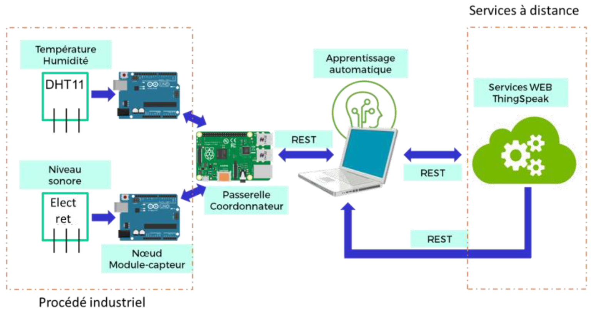

## GPA788 - Objets Connectés

### Projet de session

Le projet consiste à reproduire un pipeline de collecte, communication et traitement de données dans un contexte industriel. 

Le procédé industriel est simulé par deux capteurs : un capteur de température et d'humidité **DHT11** et un capteur sonore **Electret MAX4466**. Ces deux capteurs sont chacun reliés à un **Arduino**.

Les Arduinos échantillonnent les signaux, gèrent les erreurs et communiquent leurs données à un coordonnateur. Ils sont programmés avec le langage C++.

Le coordonnateur est un **Raspberry Pi** que l'on programme en Python. Il communique avec les deux Arduinos via le protocole de communication **I2C**. Il commnique aussi les données qu'il a recueilli à un service **Cloud** (ThingSpeak de Matlab) en utilisant le style REST.

Enfin, à partir des données accumulées sur le Cloud, nous avons mis en place un algorithme d'apprentissage profond nommé **LSTM** (Long-Short Term Memory) afin de faire des prédictions sur les signaux des capteurs. 

#### Livrable 1

Dans le dossier *test_calculateur_Leq* se trouve le code pour le capteur sonore Electret MAX4466.

Dans le dossier *test_lcd* se trouve le code pour le capteur DHT11 qui capte la température et l'humidité. 

Pour plus d'informations sur le fonctionnement de ces programmes et nos choix d'implémentation, se référer au rapport du livrable 1. 

